# Architecture and How It Works

Visual guide to the distributed rate limiter. Every diagram here renders directly on GitHub.
The charts in `docs/img/` are generated by [`generate_figures.py`](generate_figures.py).

**Suggested reading order:** 1 (big picture) -> 3 (one request) -> 5 (race conditions) -> 6 to 8 (algorithms) -> the rest.

| # | Figure | Question it answers |
|---|---|---|
| 1 | System architecture | What are the moving parts? |
| 2 | Startup sequence | What happens when the app boots? |
| 3 | Request lifecycle | What happens when a client sends a request? |
| 4 | Decision flow | What choices does `RateLimit` make? |
| 5 | Race condition | Why Lua scripts? |
| 6 | Token bucket | How does the main algorithm behave? |
| 7 | Leaky bucket | How does steady outflow work? |
| 8 | Fixed vs sliding window | Why is fixed window flawed? |
| 9 | Sliding window counter | How does the cheap approximation work? |
| 10 | All five algorithms compared | How do they differ on the same traffic? |
| 11 | Redis data model | What exactly is stored in Redis? |
| 12 | EVAL vs EVALSHA | How do scripts reach Redis? |
| 13 | Many API instances, one limit | What does "distributed" mean here? |
| 14 | Failure handling | What if Redis is down? |
| 15 | Runtime overrides | How do limits change without a redeploy? |
| 16 | Class diagram | How is the Python code organised? |
| 17 | Code map | Where do I start reading the code? |

---

## 1. System architecture

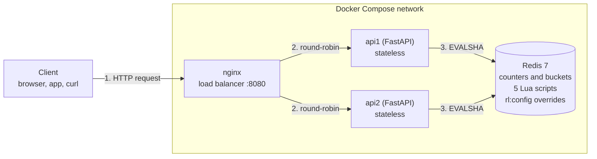

- The API instances keep **no counters in memory**. All state lives in Redis, so any instance can serve any request.
- Adding more API instances never changes correctness; Redis is the single source of truth.
- Responses travel back the same way: `200` with `X-RateLimit-*` headers, or `429` with `Retry-After`.

## 2. Startup sequence

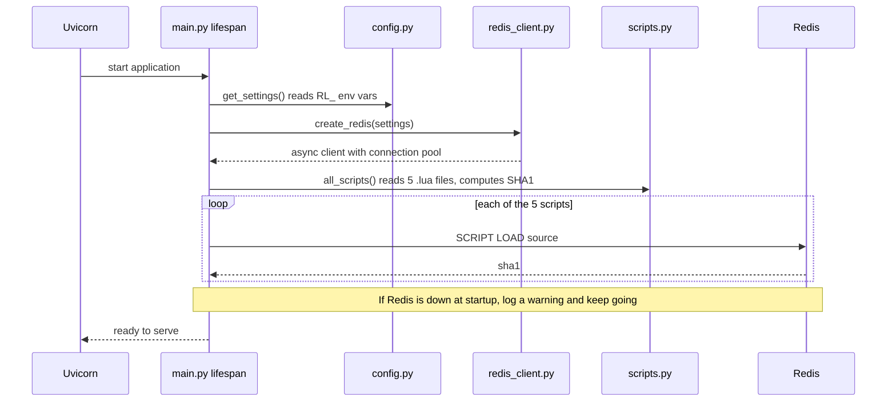

## 3. Request lifecycle (the most important diagram)

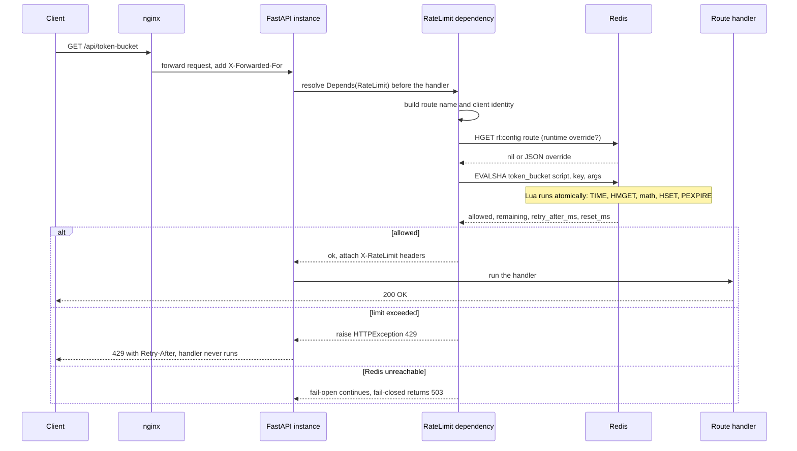

## 4. Decision flow inside `RateLimit`

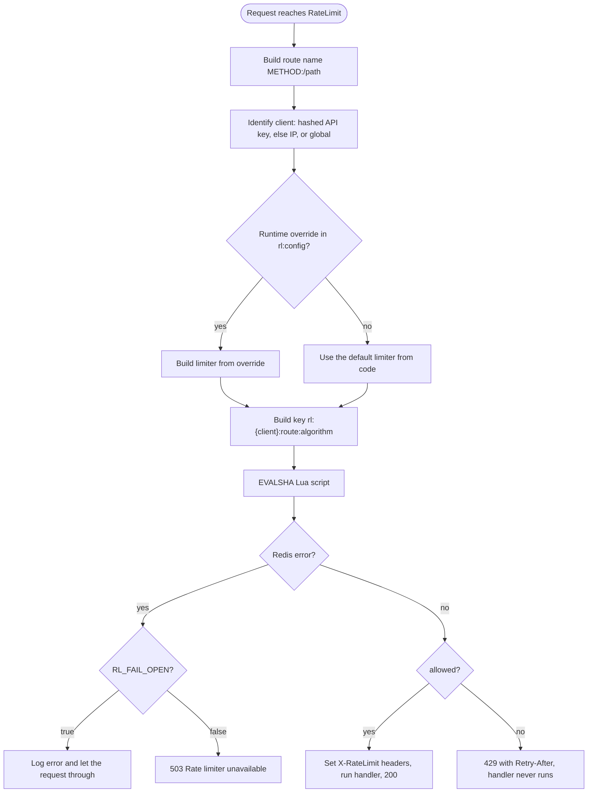

## 5. Why Lua? The race condition

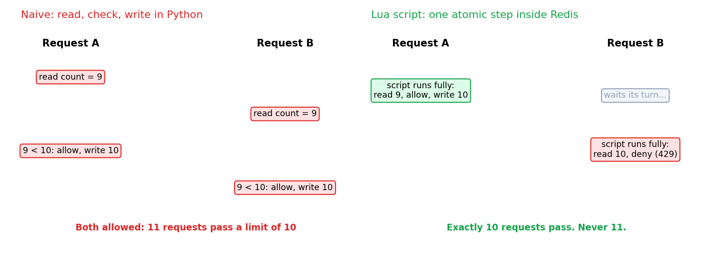

Two simultaneous requests can both read `count = 9` and both be allowed under a limit of 10.
A Lua script performs read, decide and write as **one uninterruptible step** because Redis runs a
script start to finish before touching any other command. The test suite proves it: 100 concurrent
callers against a limit of 10 allow exactly 10, for all five algorithms.

## 6. Token bucket: bursts, then a steady rate

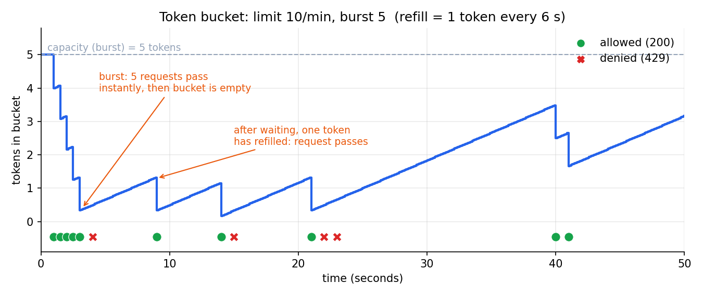

A bucket holds up to `burst` tokens and refills at `limit / window` per second. Each request spends
`cost` tokens. An empty bucket means `429`, and `Retry-After` says how long until enough tokens exist.

## 7. Leaky bucket: steady outflow

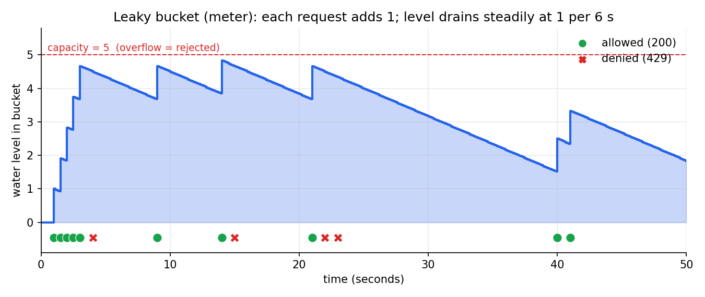

Each request adds to a level that drains at a constant rate. If adding the request would overflow the
capacity, it is rejected. This is the *meter* variant (it rejects). A queue-based leaky bucket would
delay requests instead.

## 8. Fixed window vs sliding window: the boundary problem

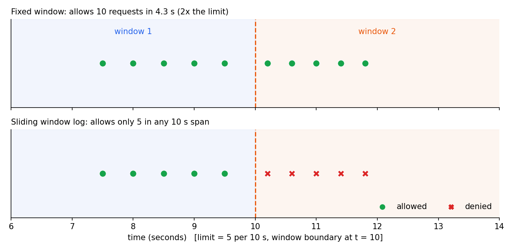

A fixed window resets at a clock boundary, so a client can send a full quota just before the reset and
another just after: **twice the limit in a few seconds**. The sliding window log looks back over the
last N seconds from *now*, so no boundary exists.

## 9. Sliding window counter: the cheap approximation

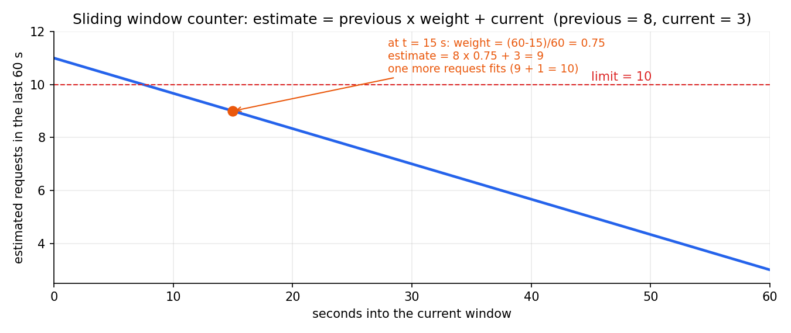

Instead of storing every timestamp, it stores two counters and blends them:
`estimate = previous_window_count x weight + current_window_count`, where the weight shrinks from 1 to 0
as the current window progresses. It uses O(1) memory and is close to exact.

## 10. All five algorithms on the same traffic

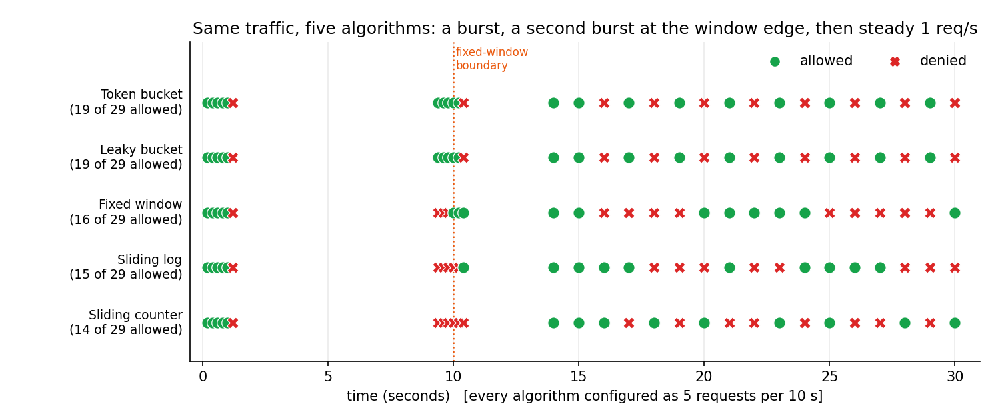

Every algorithm is configured as 5 requests per 10 seconds and receives the same traffic. Notice how
the fixed window lets the second burst through at the window edge while the sliding algorithms do not.

| Algorithm | Memory per client | Accuracy | Bursts | Best for |
|---|---|---|---|---|
| Token bucket | O(1) | exact | up to `burst` | general APIs |
| Leaky bucket | O(1) | exact | smoothed | protecting fragile backends |
| Fixed window | O(1) | up to 2x at edges | edge bursts | cheap, coarse quotas |
| Sliding log | O(limit) | exact | none | small exact limits (login) |
| Sliding counter | O(1) | approximate | minimal | high-traffic default |

## 11. Redis data model

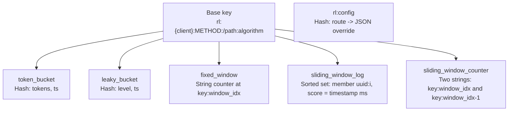

| Algorithm | Redis type | Fields / members | TTL set by the script |
|---|---|---|---|
| Token bucket | Hash | `tokens`, `ts` | time to refill fully + 1 s |
| Leaky bucket | Hash | `level`, `ts` | time to drain fully + 1 s |
| Fixed window | String | counter per window index | window + 1 s |
| Sliding log | Sorted set | `uuid:i` scored by timestamp (ms) | window + 1 s |
| Sliding counter | Two strings | current and previous window counters | 2 x window + 1 s |

The `{client}` braces are a Redis Cluster hash tag, which keeps all of one client's keys in the same slot.
Inspect live data with `redis-cli --scan --pattern 'rl:*'`, then `TYPE`, `HGETALL`, `ZRANGE key 0 -1 WITHSCORES`, `PTTL`.

## 12. EVAL vs EVALSHA

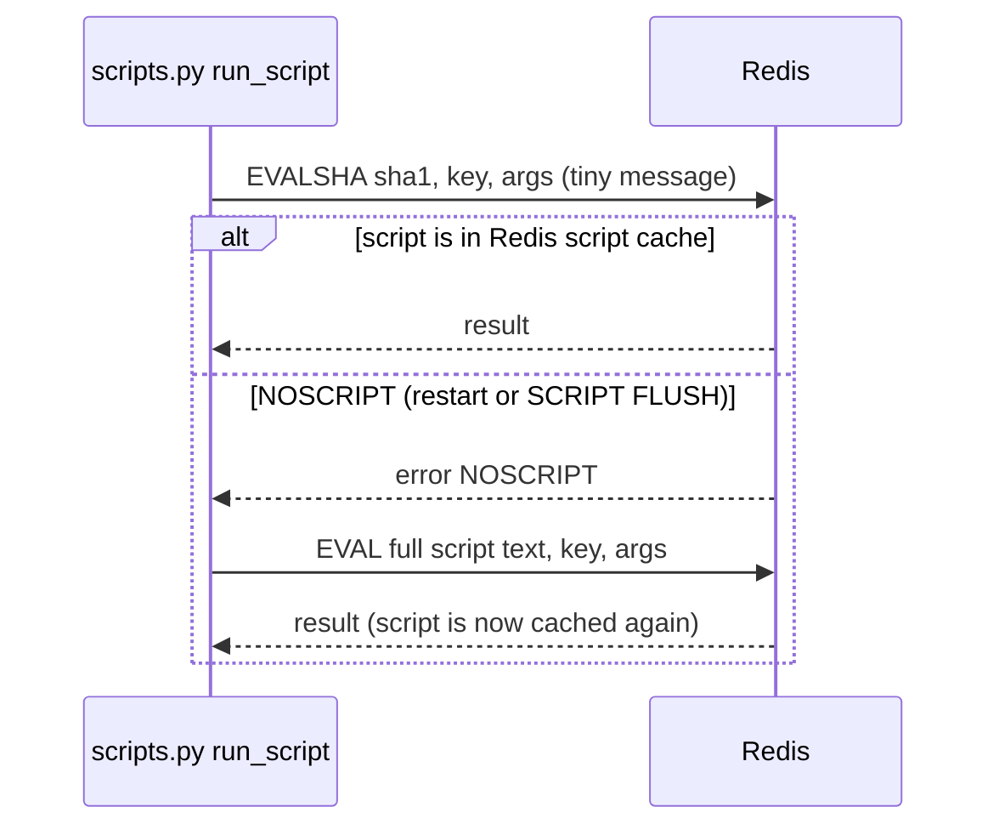

`EVAL` sends the whole Lua source every time. `EVALSHA` sends only its 40-character hash, which is
cheaper but needs the script to be cached. The app preloads all scripts at startup and falls back to
`EVAL` on `NOSCRIPT`, so users never see the error.

## 13. Many API instances, one shared limit

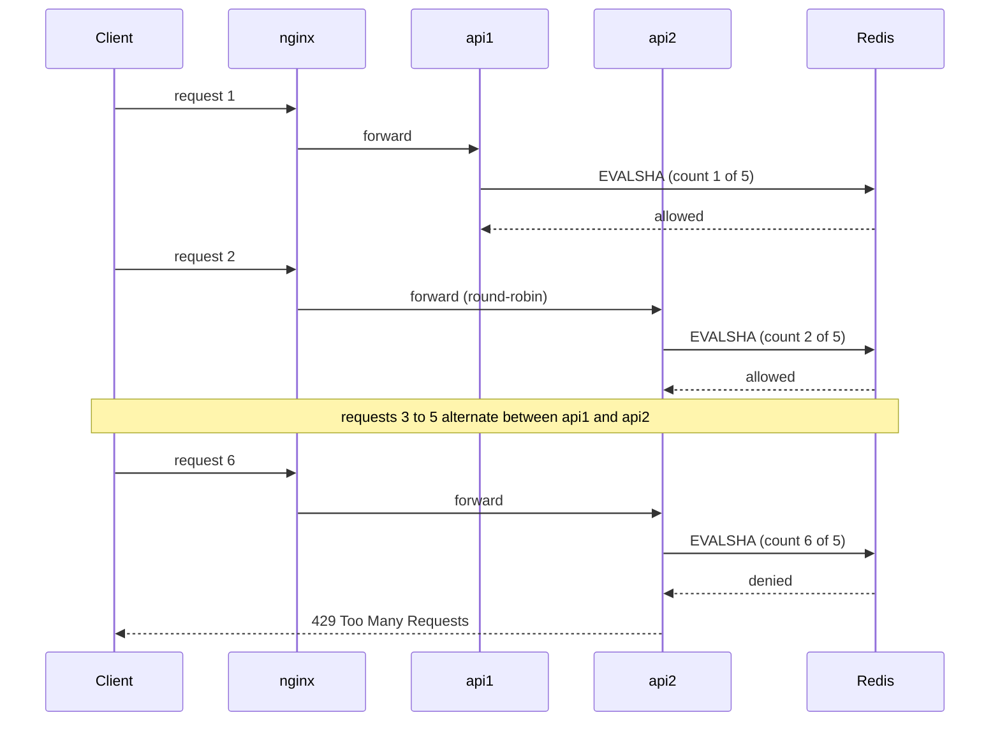

Because both instances use the same Redis key, the client gets one shared quota instead of 5 per server.

## 14. Failure handling

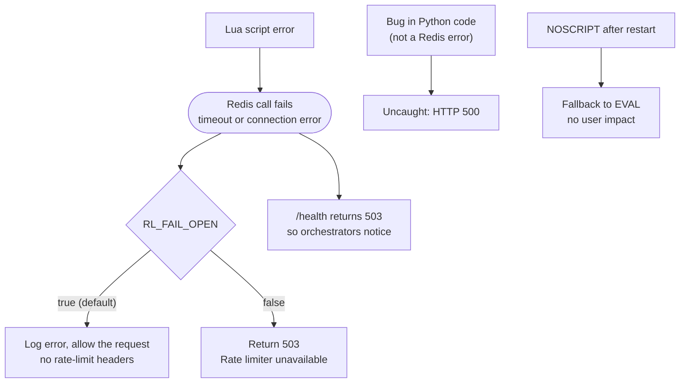

Trade-off: fail-open keeps the API alive but removes protection during an outage. A stricter policy
(fail-closed) suits login or OTP routes.

## 15. Runtime overrides (change limits without a redeploy)

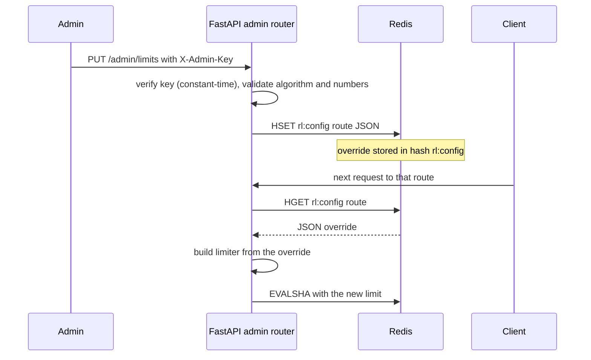

## 16. Class diagram

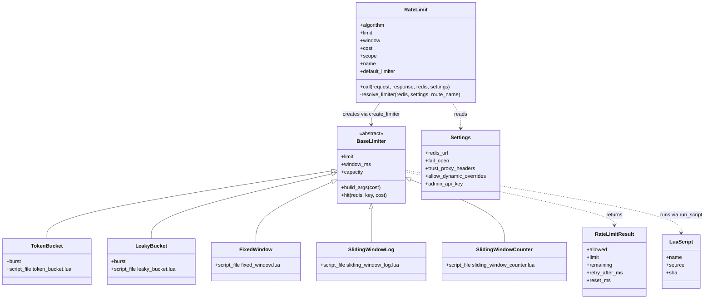

Patterns: **Strategy** (interchangeable algorithms), **Factory** (`create_limiter`), **Template method**
(`hit()` in the base class calls the subclass's `build_args()`), **Dependency injection** (`Depends`).
In the code, `call` is the Python `__call__` method and `resolve_limiter` is `_resolve_limiter`.

## 17. Code map: where to start reading

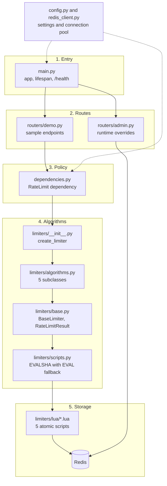

Read in this order: `config.py`, `redis_client.py`, `main.py`, `routers/demo.py`, `dependencies.py`,
`limiters/` (`__init__`, `base`, `algorithms`, `scripts`), then the five `lua/*.lua` scripts, `routers/admin.py`, and finally `tests/`.

---

*Regenerate the charts with:* `pip install matplotlib && python docs/generate_figures.py`
